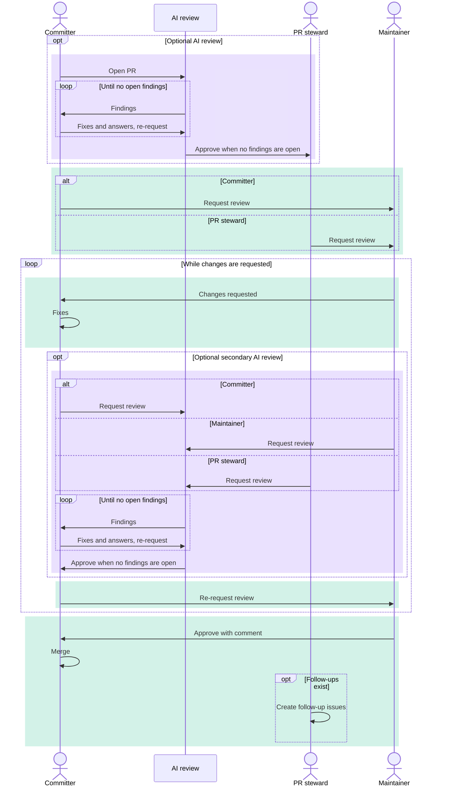
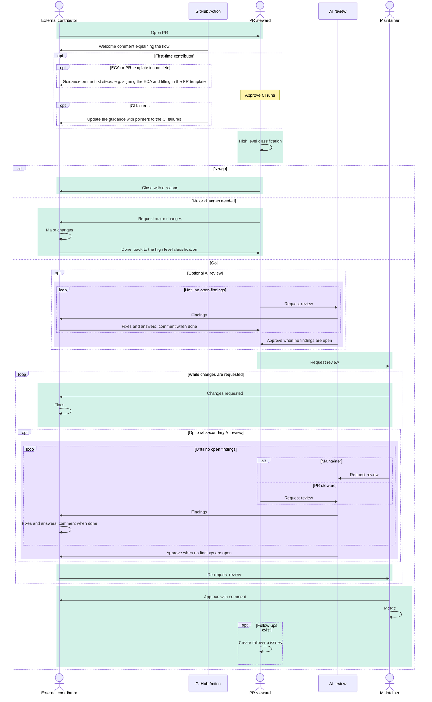

# Pull Requests

This document clarifies rules and expectations of contributing and reviewing pull requests.
It is structured as a list of rules which can be referenced on a PR to moderate and drive discussions.
If a rule causes distress during discussions itself, it has to be reviewed on [the dev meeting](https://github.com/eclipse-theia/theia/wiki/Dev-Meetings) and updated.

- [**Opening a Pull Request**](#opening-a-pull-request)
- [**Requesting a Review**](#requesting-a-review)
- [**Review Flow**](#review-flow)
- [**Review Checklist**](#review-checklist)
- [**Reviewing**](#reviewing)
- [**Landing**](#landing)
- [**Reverting**](#reverting)
- [**Closing**](#closing)

## Opening a Pull Request

- [1.](#pr-template) Each PR description has to follow the [PR template](https://github.com/eclipse-theia/theia/blob/master/.github/PULL_REQUEST_TEMPLATE.md)

- [2.](#human-in-the-loop) Contributors can use whatever tools they would like to craft their contributions, but there must be a human in the loop. Contributors must read and review all LLM-generated code or text before they ask other project members to review it. The contributor is always the author and is fully accountable for their contributions. Contributors should be sufficiently confident that the contribution is high enough quality that asking for a review is a good use of scarce maintainer time, and they should be able to answer questions about their work themselves during review.

- [3.](#design-review) A PR can be opened early for the design review before going into the detailed implementation.
  - A request on the design review should be an explicit comment.
  - Such PR should be marked as a draft.
  - Drafts get no automatic [AI review](#review-flow).

- [4.](#fixups) Changes done _after_ the PR has been opened should be kept in separate commits until the review process is finished. This allows reviewers to re-review only the updated parts of the PR and to determine what needs to be tested again. The "fixup" commits must be squashed before merging in order to keep a clean history.

- [5.](#changelog-entry) A changelog entry is only mandatory for [breaking changes](#checklist-breaking-changes), which are declared in the `Breaking changes` section of the PR description. PRs with non-breaking changes should _not_ add an entry to [CHANGELOG.md](https://github.com/eclipse-theia/theia/blob/master/CHANGELOG.md); their entries are collected at [release time](Publishing.md#15-update-changelog).

  > Why? It avoids the frequent merge conflicts in `CHANGELOG.md` that a manual entry per PR causes.

## Requesting a Review

- [1.](#review-reqs) A review can be requested when:
  - [The PR template](#pr-template) is filled in.
  - Changes are thoroughly tested by an author.
  - Changes thoroughly reviewed following the [review checklist](#review-checklist) by an author.

- [2.](#review-request-open) Any open non-draft PR is considered to be a request for review.

## Review Flow

AI-powered tools may support the review. They run automatically on PRs of committers who opted in, and the PR steward can request them for PRs of external contributors. Without an AI review, the PR goes directly to a reviewer.

The flow depends on the author. External contributors are authors without write access to the repository.

- [1.](#flow-roles) The flow has these roles:
  - Author: Opens the PR and addresses findings and requested changes
  - PR steward: A committer who moves the PR through the flow
  - AI review: An AI agent that reviews the PR, e.g. [EclipseSourceAI](https://github.com/EclipseSourceAI)
  - Maintainer (Human reviewer): A committer who reviews and approves the PR

- [2.](#ai-review-findings) The author fixes or answers each AI finding. The AI review approves once all findings are fixed or answered, and reviewers settle answered findings in their review. The AI approval does not count for merging.

- [3.](#ai-review-rounds) Without an AI approval after multiple rounds, the PR steward decides how to continue.

- [4.](#ai-review-approval) After the AI approval, the PR steward requests a human review. On committer PRs, the author may do that too.

- [5.](#ai-review-secondary) After fixes for requested changes, the reviewer or the PR steward may request a secondary AI review before the next human review. On committer PRs, the author may request it too.

- [6.](#follow-up-issues) After the merge, the PR steward creates issues for the `Follow-ups` of the PR description and for [out of scope changes](#changes-no-out-of-scope) that have no issue yet.

In the diagrams below, purple marks AI steps and green marks human steps.

### Committer Flow

- [1.](#flow-committer) Committers opt in to the AI review. It then starts automatically when they open a non-draft PR or mark a draft PR as ready for review. To postpone it, they open a draft PR.

- [2.](#flow-committer-rereview) The author re-requests the AI review after fixing or answering the findings.

- [3.](#flow-committer-review-request) The author may request a review from a maintainer or wait for the PR steward to do it.

- [4.](#flow-committer-merge) The author merges after the approval of a maintainer, see [merging](#merging-pr).

- [5.](#flow-committer-consultation) Substantial behavior changes need reviews from maintainers of several organizations, see [review consultation](#review-consultation).

### External Contributor Flow

- [1.](#flow-external-welcome) A GitHub Action welcomes the author with a summary of this flow. For first-time contributors, a second comment lists failed basic checks: a missing [ECA](https://github.com/eclipse-theia/theia/blob/master/CONTRIBUTING.md#eclipse-contributor-agreement), lint errors, more than one failed CI job or an incomplete [PR template](#pr-template). The comment is removed once they pass.

- [2.](#flow-external-classification) The PR steward approves pending CI runs before or with the high level classification. The classification is one comment on the approach, no line comments:
  - Go: The steward requests the AI review or, if it is skipped, a review from a maintainer
  - Major changes: The author reworks the PR and comments when done. The steward then classifies it again.
  - No-go: The steward closes the PR with a reason, see [closing](#closing-pr-reasons)

- [3.](#flow-external-ai-review) The author fixes or answers the AI findings and comments on the PR when done. The PR steward then requests the next AI review round.

- [4.](#flow-external-merge) A committer of the author's organization or, if none is available, the approving maintainer merges the PR, see [merging](#merging-pr).

## Review Checklist

- [1.](#checklist-build-and-test) The new code is built and tested according to the `How to test` section of a PR description.

- [2.](#checklist-project-org) The new code is aligned with the [project organization](code-organization.md) and [coding conventions](coding-guidelines.md).

- [3.](#checklist-breaking-changes) Breaking changes are justified and recorded in the [changelog](https://github.com/eclipse-theia/theia/blob/master/CHANGELOG.md).
  - Whether a PR is breaking is declared in the `Breaking changes` section of its description. Non-breaking changes need no changelog entry, see [the changelog rule](#changelog-entry): a missing entry is not a review finding, and an entry added for a non-breaking change should be dropped.

- [4.](#checklist-dependencies) New dependencies are justified and [verified](https://github.com/eclipse-theia/theia/wiki/Registering-CQs#wip---new-ecd-theia-intellectual-property-clearance-approach-experimental).
  - For newly added dependencies, we run the [license check workflow](../.github/workflows/license-check.yml), but not in review mode.
    - If the license check reveals that a review is needed for the new dependency (i.e., `ERROR: Found results that aren't part of the baseline! X some-dependency, some-license`), we need to run the license check in review mode (`npm run license:check:review`).
    - Since we have no PAT secret defined for the repo at the moment, the license check in review mode needs to be done locally, either by the contributor (if they are a Theia committer) or by the reviewer.

- [5.](#checklist-copied-code) Copied code is justified and [approved via a CQ](https://github.com/eclipse-theia/theia/wiki/Registering-CQs#case-3rd-party-project-code-copiedforked-from-another-project-into-eclipse-theia-maintained-by-us).
  - Look closely at the GitHub actions running for your PR: the 3pp/dash license check should be green.
  - If red: it most likely mean you need to create a CQ.

- [6.](#checklist-copyright) Each new file has proper copyright with the current year and the name of contributing entity (individual or company).

- [7.](#checklist-meaningful-commits) Each commit has meaningful title and a body that explains what it does. One can take inspiration from the `What it does` section from the PR.

- [8.](#checklist-commit-history) Commit history is rebased on master and contains only meaningful commits and changes (less are usually better).
  - For example, use `git pull -r` or `git fetch && git rebase` to pick up changes from the master.

- [9.](#checklist-i18n) User-facing text is internationalized using the `nls` service.
  - For details, please see the [Internationalization/Localization section](./coding-guidelines.md#internationalizationlocalization) in the Coding Guidelines.

## Reviewing

- [1.](#reviewing-template) Reviewers should check that a PR has a [proper description](#pr-template).

- [2.](#reviewing-fn) Reviewers should build and verify changes according to the `How to test` section of a PR description.

- [3.](#reviewing-checklist) Reviewers should ensure that all checks from [the review checklist](#review-checklist) are successful.

- [4.](#reviewing-share) A reviewer does not need to ensure everything but can verify a part of it and provide feedback as a comment.

- [5.](#review-consultation) For any change that substantially alters the behavior of the application or one of its components, reviews should be requested from representatives of several contributing organizations to ensure consistency with the goals of the project and compatibility with significant adopters' downstream products.

### Requesting Changes

- [1.](#changes-review-reqs) Changes should be requested if an author does not follow the [review requirements](#review-reqs).

- [2.](#changes-no-nit) Changes cannot be requested because of the personal preferences of a reviewer.
  - Such change requests should be dismissed.

- [3.](#changes-no-out-of-scope) Changes cannot be requested if they address issues out of the scope of a PR.
  - Such change requests should be dismissed and an issue should be filed to address them separately.
  - This also applies to AI findings. The PR steward files the issues, see [follow-up issues](#follow-up-issues).

- [4.](#changes-style-agreement) Styles and coding preferences should not be discussed on the PR, but raised in [the dev meeting](https://github.com/eclipse-theia/theia/wiki/Dev-Meetings),
  agreed by the team, applied to [the coding guidelines](coding-guidelines.md) and after that followed by all contributors.

### Approving

- [1.](#justifying-approve) Each approval should have supporting comments following these guidelines.

- [2.](#dismissing-approve) An approval without a comment should be dismissed.

- [3.](#approval-finality) Approval of a PR implies that the reviewer is prepared to merge the PR. A reviewer should only approve a pull request that they are prepared to merge it. If a PR is under review by multiple reviewers, reviewers who are not satisfied with the state of the PR should block its merge, for example by marking their review 'request changes'.

- [4.](#ai-approval-not-sufficient) An [AI approval](#ai-review-approval) is not sufficient. A maintainer has to approve the PR.

### Collaborating

- [1.](#collaboration-on-pr) If a change request is important, but cannot be elaborated by a reviewer,
then a reviewer should be encouraged to open an alternative PR or collaborate on a current PR.

- [2.](#completing-pr) If a PR is important, but an author cannot or does not want to address outstanding issues,
then maintainers can complete the PR with additional commits
provided that the original author accepted the [ECA](https://github.com/eclipse-theia/theia/blob/master/CONTRIBUTING.md#eclipse-contributor-agreement) and their commits are preserved - the original author's work should not be squashed away.

- [3.](#suggesting-help-on-pr) Reviewers should offer their help via a comment to avoid intervening in an author's work.

- [4.](#landing-stale-pr) Such comment is not required if an author is not responsive.

## Landing

- [1.](#landing-pr) A PR can be landed when:
  - CI build has succeeded.
  - The author has accepted the [Eclipse Contributor Agreement](https://github.com/eclipse-theia/theia/blob/master/CONTRIBUTING.md#eclipse-contributor-agreement).
  - All checks from [the review checklist](#review-checklist) are approved by at least one reviewer. The [AI approval](#ai-review-approval) does not count.
  - There are no unresolved review comments.

- [2.](#merging-pr) Pull requests satisfying the criteria above should be merged in a timely fashion to avoid a buildup of approved PR's at release time. Responsibility for merging a PR falls to
  - The author, if the author is a committer.
  - A committer from the author's organization, if one is available.
  - The approving reviewer, otherwise.

## Reverting

- [1.](#reverting-pr) If a PR causes regressions after landing
then an author and maintainers have 2 days to resolve them after that a PR has to be reverted.

## Closing

- [1.](#closing-pr) A reviewer cannot close a PR without a reason.

- [2.](#closing-pr-reasons) A PR may be closed, for example, because of the following reasons:
  - It introduces functionality which should be implemented as external Theia or VS Code extensions.
  - It introduces structural or API changes between core extensions.
  Such changes have to be done by an experienced maintainer to avoid regressions and long reviews.
  - It should be a 3rd party component, e.g. Theia is not a logging framework or a proxy server.
  - It changes development infrastructure, e.g. testing frameworks, packaging and so on.
  Such changes have to be done by active maintainers after agreement in [the dev meeting](https://github.com/eclipse-theia/theia/wiki/Dev-Meetings).
  - It violates the [human-in-the-loop](#human-in-the-loop) policy.
