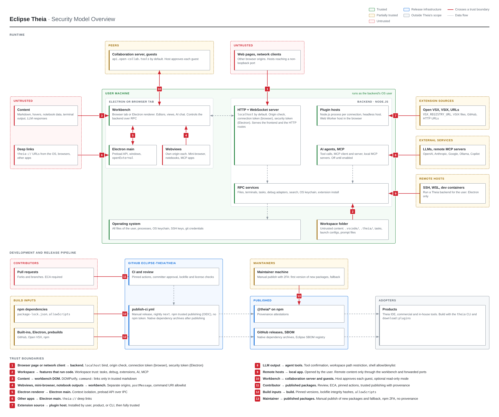

# Eclipse Theia Security Model

- Scope: the Eclipse Theia framework, the example applications, and the development and release pipeline of this repository.
- Theia is a framework. Adopters compose products from its packages and own the security of their product, deployment, and configuration. See [Adopter responsibilities](#adopter-responsibilities).
- Report vulnerabilities through coordinated disclosure per [`SECURITY.md`](../../SECURITY.md). Never via public issues or PRs.

## Deployment scenarios

### Runtime targets

The example apps are private and never published. They demonstrate features and run only on contributors' machines (A3).

| ID | Target | Backend runs | Who connects | Example app | Status |
|---|---|---|---|---|---|
| RT1 | **Electron** | Child process of Electron main, `localhost`, random port | The local user's Electron renderer | `examples/electron` | Supported |
| RT2 | **Browser, local** | Node.js process, `localhost:3000` by default | A browser on the same machine | `examples/browser` | Supported |
| RT3 | **Browser, hosted, one user per backend** (e.g. Theia Cloud, Eclipse Che) | Isolated container or VM per user, `--hostname` set by the operator | The user's browser through the operator's gateway | none | Supported, adopter provides auth, TLS, and isolation |
| RT4 | **Browser-only** | No backend. Static files, files in the browser's origin private file system (OPFS) | A browser | `examples/browser-only` | Supported |
| | **Browser, hosted on a plain host**, one or several users | Node.js process directly on the host, no container or VM | Browsers on other machines | none | **Not supported.** Every connection has the full power of the backend's OS user on that host |

### Features

Features that change the topology of a target.

| ID | Feature | Targets | Topology | Status |
|---|---|---|---|---|
| F1 | **Remote development**: SSH, WSL, dev containers | RT1 | A Theia backend on the remote host or in the container, tunneled to the local app | Supported |
| F2 | **Collaboration session** (Open Collaboration Tools) | RT1, RT2, RT3 | Host's normal backend, guests connect through the collaboration server | Supported, host approves each guest |

### Actors

| ID | Who | Activity | Attack surface |
|---|---|---|---|
| A1 | End user | Runs a product built on RT1 to RT4 | Runtime targets and features above |
| A2 | Adopter | Builds a product from `@theia/*` on npm, the `theia` CLI, `theia download:plugins` | Published packages, CLI, build-time downloads |
| A3 | Contributor | Develops Theia: `npm install`, build, runs the example apps | Install scripts, `theia-patch` patches, `afterInstall` hooks, repository launch configs, CI |

## Overview

Source: [`overview.html`](overview.html). Numbers are the [trust boundaries](#trust-boundaries).

## Trust zones

Trust levels, colored the same way in the overview:

- **Trusted** (green, blue for release infrastructure).
- **Partially trusted** (yellow): trusted in general, but some parts must be checked before they take effect, for example by workspace trust, install consent, tool confirmation, or pinned versions.
- **Untrusted** (red).

| Zone | Trust | Contents |
|---|---|---|
| Backend | Trusted | Node.js backend, plugin hosts, AI agents. Run as one OS user with that user's full power |
| Frontend | Trusted | Workbench in a browser tab or Electron renderer. Controls the backend over RPC, so script in the workbench origin equals backend access |
| Electron main | Trusted | Window management, preload API, OS integration |
| Isolated frontend content | Untrusted | Webviews, mini-browser, notebook outputs, MCP apps. Each runs in its own origin or sandboxed iframe |
| Workspace | Partially trusted | Every file in the opened folders, including `.vscode/`, `.theia/`, tasks, launch configs, prompt files, `devcontainer.json`. Code runs only after the user grants workspace trust (boundary 2) |
| Content | Untrusted | Text Theia renders without running: markdown, hovers, diagnostics, terminal output, notebook data, LLM responses |
| Extensions | Trusted | Installed VS Code extensions and Theia plugins. Full Node.js, same OS user, same as in VS Code |
| Local MCP servers | Trusted | Processes the user configured in `ai-features.mcp.mcpServers`. Same OS user |
| Extension sources | Partially trusted | Open VSX (`VSX_REGISTRY_URL`), VSIX files, GitHub, HTTP URLs. Extensions run only after the user, the product, or the CLI installs them (boundary 7) |
| External services | Partially trusted | LLM providers, remote MCP servers. Receive what a feature sends them. Their output acts only through confirmed tool calls (boundary 8) |
| Peers | Partially trusted | Collaboration server and guests. Host approves each guest. Guests reach only the shared workspace, optionally read-only (boundary 10) |
| Remote hosts | Partially trusted | SSH hosts, WSL, dev containers. Run a Theia backend for the user. Reach the local machine only through the workbench and forwarded ports (boundary 9) |
| Web and network | Untrusted | Other origins in the user's browser, hosts that reach a listening port, apps that open `theia://` links |
| Contributors | Untrusted | Pull requests from forks and branches. Merged only after review (boundary 11) |
| Maintainers | Partially trusted | Maintainer machines that publish manually. Every publish needs the npm account's 2FA (boundary 13) |
| Build inputs | Partially trusted | npm dependencies, built-in extensions, Electron, native prebuilds. Versions pinned in reviewed PRs (boundary 12) |
| Release infrastructure | Trusted | GitHub repository, GitHub Actions, npm trusted publishing, `@theia/*` on npm, GitHub releases |

## Trust boundaries

| # | Crossing | Control |
|---|---|---|
| 1 | Browser page or network client → backend | Bind address (`localhost`). WebSocket `Origin` must match `Host` or `THEIA_HOSTS`. Browser: connection token cookie (`theia-connection-token`, `SameSite=Strict`, `HttpOnly`) on WebSocket upgrades and file routes. Electron: per-launch security token |
| 2 | Workspace → features that run code | Workspace trust: tasks, debug sessions, extensions without `untrustedWorkspacesSupport`, AI features, MCP autostart, workspace-scoped AI settings and prompt templates |
| 3 | Content → workbench DOM | Markdown sanitized with DOMPurify. `command:` links only in trusted markdown. External resources in AI chat blocked |
| 4 | Webviews, mini-browser, notebook outputs → workbench | Separate origin per webview, iframe sandbox, `postMessage` protocol, `localResourceRoots`, command URI allowlist. Webview origins refused for backend WebSocket |
| 5 | Electron renderer → Electron main | Context isolation, no Node.js integration, preload API over IPC. In-app navigation blocked, `window.open` goes to the system browser |
| 6 | Other apps → Electron main | `theia://` deep links routed to the workbench's opener service |
| 7 | Extension source → plugin host | Installed by the user, the product, or the CLI. Extensions are fully trusted afterwards |
| 8 | LLM output → agent tools | Tool confirmation (`confirm` by default), workspace path restriction, shell command allow/denylist, agent mode needs one-time consent. External agent CLIs apply their own permission modes |
| 9 | Remote hosts → local app | Connection opened by the user. Remote content reaches the local machine only through the workbench (boundaries 3 to 5) and ports the user forwards |
| 10 | Workbench ↔ collaboration server and guests | Host approves each guest, optional read-only mode |
| 11 | Contributor → published packages | Review, ECA, maintainer approves external CI runs, actions pinned by SHA, npm trusted publishing with provenance |
| 12 | Build inputs → build | Versions pinned in reviewed PRs: `package-lock.json` with integrity hashes, versioned `theiaPlugins` URLs. Install scripts only from the `allowScripts` allowlist |
| 13 | Maintainer → published packages | Manual publish for the first version of a new package and as fallback. npm account with 2FA, no provenance |

## Components and entry points

| Component | Runs in | Reachable from | Power | Packages |
|---|---|---|---|---|
| HTTP + WebSocket server | Backend | Browser tab, Electron renderer, anything that reaches the port | Serves the frontend, carries all RPC | `core/src/node` |
| RPC services | Backend | Any connected frontend | File system (not limited to the workspace), terminals, tasks, debug adapters, search, environment, OS keychain, extension install | `filesystem`, `terminal`, `task`, `debug`, `process`, `search-in-workspace`, `plugin-ext`, `core` |
| HTTP routes | Backend | Browser and other HTTP clients | `/files`, `/file`, `/file-upload` (connection token), `/webview/*`, `/mini-browser/*`, `/hostedPlugin/*`, `/metrics` (`@theia/metrics`), `/mcp` (`@theia/ai-mcp-server`), external API (opt-in) | `filesystem`, `plugin-ext`, `mini-browser`, `metrics`, `ai-mcp-server`, `external-api` |
| Workbench | Browser tab or Electron renderer | User, rendered content | Everything the RPC services offer | `core/src/browser`, all `src/browser` |
| Webviews, notebook outputs | Iframe, own origin `{{uuid}}.webview.{{hostname}}` | Extension content | `postMessage` to the extension, allowlisted `command:` links | `plugin-ext`, `notebook` |
| Mini-browser | Iframe, own origin `{{uuid}}.mini-browser.{{hostname}}` | Previewed pages | Shows local files and web pages | `mini-browser` |
| Electron main | Electron main process | Renderer via preload API (`window.electronTheiaCore`), OS deep links (`theia://`) | Windows, menus, `openExternal`, Electron security token | `core/src/electron-main`, `electron` |
| Plugin hosts | Node.js child process per frontend connection, one headless host, Web Worker in the browser | Extensions | Full Node.js (worker: browser APIs only) | `plugin-ext`, `plugin-ext-vscode`, `plugin-ext-headless` |
| Extension sources | Backend | User, product config, CLI | `local-dir:`, `.vsix`, `github:`, `http(s)` URLs, Open VSX (`VSX_REGISTRY_URL`) | `plugin-ext`, `vsx-registry`, `ovsx-client` |
| AI agents and tools | Frontend + backend | User prompts, content the agent reads | File read and write, shell commands, tasks, launch configs, MCP tools | `ai-*` |
| LLM and agent integrations | Backend | Provider APIs, external CLIs | Claude Code, Codex, Copilot CLIs spawned locally. OAuth callbacks on loopback | `ai-anthropic`, `ai-openai`, `ai-claude-code`, `ai-codex`, `ai-copilot`, `ai-chatgpt`, others |
| MCP client | Backend | MCP servers configured in `ai-features.mcp.mcpServers`, `install-mcp` deep links, OAuth callbacks on loopback | Spawns local MCP servers (stdio), connects to remote ones (SSE, streamable HTTP). OAuth tokens in the OS keychain. Server tools available to AI agents | `ai-mcp` |
| MCP server | Backend, `/mcp` on the backend port | MCP clients, e.g. external agent CLIs | Tools, resources, and prompts contributed by Theia extensions. The framework packages contribute none | `ai-mcp-server` |
| External API | Backend, opt-in | Local processes | REST API, e.g. AI chat sessions | `external-api`, `ai-external-api` |
| Remote | Electron backend, remote host | SSH hosts, WSL, Docker | Copies and starts a Theia backend remotely, forwards ports | `remote`, `remote-wsl`, `dev-container` |
| Collaboration | Frontend | Collaboration server, guests | Shares the workspace with approved guests | `collaboration` |
| Secrets | Backend | Frontend RPC, extensions | OS keychain via `keytar`, extension `SecretStorage` per extension ID | `core`, `plugin-ext` |

### Defaults

Settings that shape the attack surface.

| Setting | Default | Notes |
|---|---|---|
| `--hostname` | `localhost` | Port 3000 (browser), random (Electron) |
| `--ssl` | off | Needs `--cert` and `--certkey` |
| `THEIA_HOSTS` | unset | Allowed `Origin` hosts for WebSocket connections |
| `THEIA_WEBVIEW_EXTERNAL_ENDPOINT`, `THEIA_MINI_BROWSER_HOST_PATTERN` | `{{uuid}}.webview.{{hostname}}`, `{{uuid}}.mini-browser.{{hostname}}` | Warnings for other patterns: `webview.warnIfUnsecure`, `warnOnPotentiallyInsecureHostPattern` |
| `security.workspace.trust.enabled` | `true` | `examples/browser` sets `false` |
| `ai-features.AiEnable.enableAI` | `false` | AI off until enabled. Inactive in untrusted workspaces |
| `ai-features.chat.defaultToolConfirmation` | `confirm` | `shellExecute` always asks unless the command matches the allowlist |
| `ai-features.workspaceFunctions.allowedExternalPaths` | empty | AI file tools limited to workspace roots |
| `telemetry.telemetryLevel` | `off` | No telemetry sink in the framework |
| `externalApi.delivery` | off | Bearer token optional |
| Electron `webPreferences` | `contextIsolation: true`, `nodeIntegration: false` | Product `electron.windowOptions` can override |

## Development and release pipeline

- **Source control**
  - PRs need at least one committer approval and a signed Eclipse Contributor Agreement (ECA).
  - Pending CI runs of external contributors are approved by a maintainer.
- **CI**
  - All actions pinned by commit SHA.
  - `npm ci` against the committed `package-lock.json`.
  - Lockfile and `allowScripts` verification.
  - License check with Eclipse Dash.
- **Install scripts**
  - Allowlisted in root `package.json` (`allowScripts`).
  - Root `postinstall` applies `theia-patch` patches and runs `afterInstall` hooks.
- **Publishing**
  - `publish-ci.yml`, started manually for releases, nightly for `next`.
  - npm trusted publishing (OIDC) with provenance. No npm token in the repository.
  - New packages: the first version is published manually by a maintainer with 2FA.
  - Fallback: manual publish by a maintainer with 2FA (unsigned).
- **Other release outputs**
  - Native dependency archives: built by `native-dependencies.yml` after publishing, attached to GitHub releases.
  - SBOM: generated with cdxgen on release, uploaded to the Eclipse SBOM registry.
- **Build-time downloads for examples and adopters:** `theia download:plugins` fetches the extensions listed in `theiaPlugins` from GitHub and Open VSX.

## Assumptions and non-goals

- **One backend, one user.** Theia has no user accounts, no authentication, and no authorization between connections. Every connection that passes boundary 1 has the full power of the backend's OS user.
- **Hosted deployments are supported only as RT3.** One isolated container or VM per user, an authenticating gateway, TLS, and matching `THEIA_HOSTS` and host patterns. Theia does not provide these. A backend that serves remote browsers directly from a host is out of scope, for one user or several.
- **Browser mode on a shared machine.** Any process that reaches the backend port can obtain the connection token. Loopback binding limits this to local processes.
- **Extensions are not sandboxed.** Installing an extension trusts its author, same as in VS Code. Registry vetting belongs to the registry.
- **Trusted workspaces run code.** Workspace trust is a consent gate, not a sandbox. A trusted workspace can run tasks, debug configurations, and build scripts.
- **Prompt injection is not preventable.** Theia limits what an agent can do without consent. Users who auto-approve tools or widen `allowedExternalPaths` accept the risk. External agent CLIs (Claude Code, Codex, Copilot) enforce their own permissions.
- **Attackers with the user's OS account** are out of scope.
- **The example applications** demonstrate features. They are not hardened products.
- **Bundled VS Code built-in extensions** and other third-party extensions are maintained upstream.

## Adopter responsibilities

- Choose the packages and features your product includes. Each AI, remote, collaboration, or external API package adds entry points.
- Keep the backend on `localhost` unless an authenticating gateway sits in front of it.
- Hosted: one container or VM per user, TLS, `THEIA_HOSTS`, webview and mini-browser host patterns on separate origins.
- Keep workspace trust enabled for products that open untrusted code.
- The boundaries in this doc hold for Theia's defaults and safe configurations. Changed defaults and other customizations in your product are your responsibility.
- Your product's build, packaging, distribution, and updates are outside Theia's scope.
