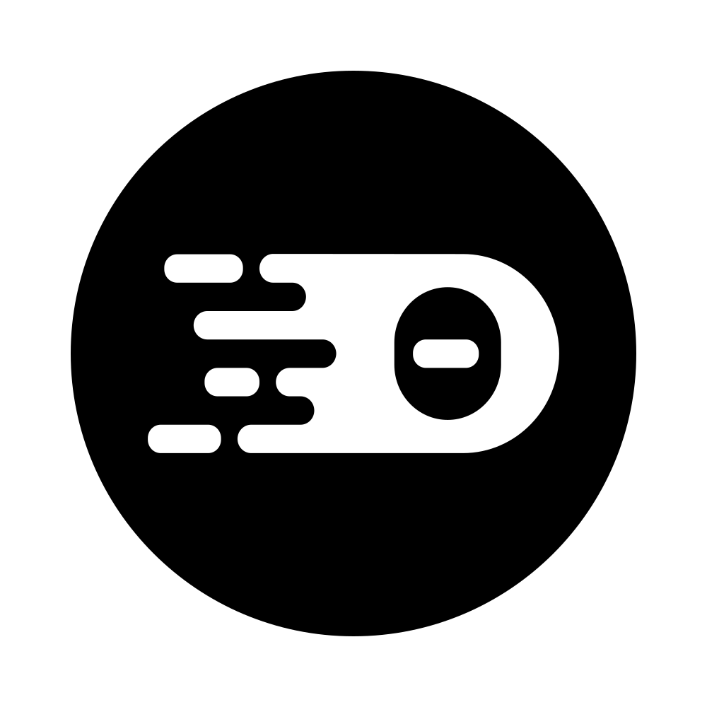

 

<h2>ECLIPSE THEIA - MONACO EXTENSION</h2>

## Description

The `@theia/monaco` extension contributes the integration of the [monaco-editor](https://microsoft.github.io/monaco-editor/).\
This includes:

- full-feature code editor
- diff-editor
- code snippets
- textmate grammars (theme registry, service)

## Monaco Uplifts

This package is intended to be the interface between the `@theia/monaco-editor-core` package, the project's bundling of the `monaco-editor-core` package published by the VSCode
team, and the rest of the application. When we uplift to a new version of `monaco-editor-core`, this package will need to be checked particularly thoroughly. To facilitate that
process, the steps for undertaking a Monaco uplift are outlined here.

### Setting up the VSCode side

1. Clone the VSCode repo and make sure you have the following remotes:

- <https://github.com/microsoft/vscode.git> - the official VSCode repo.
- <https://github.com/eclipsesource/ms-vscode.git> - the fork used for building `@theia/monaco-editor-core`.

2. Pick the target release tag in the official VSCode repo, and find the most recent uplift branch in the fork.
   The target should usually match the VS Code API version that Theia declares as supported (`DEFAULT_SUPPORTED_API_VERSION` in `dev-packages/application-package/src/api.ts`).

 > The last uplift used the release tag `1.144.0` and the uplift branch `monaco_uplift_1.144.1` (<https://github.com/eclipsesource/ms-vscode/tree/monaco_uplift_1.144.1>).

3. Create a branch `monaco_uplift_<version>` from the release tag, cherry pick the tip of the previous uplift branch, and resolve any conflicts.

 > As you resolve conflicts and make changes to the VSCode repo, make sure you end up with a single commit on the uplift branch to make it easier for the next person to rebase.

4. Use the Node.js version from the `.nvmrc` of the VSCode release tag, then build: `npm install` and `npm run gulp editor-distro`. The output is written to `out-monaco-editor-core/`.
5. Fix any build errors that arise.
6. Change the version in `build/monaco/package.json`. It follows the VSCode version it is based on, with a higher patch number for Theia-specific rebuilds (e.g. `1.108.201` for VSCode `1.108.2`, `1.144.1` for VSCode `1.144.0`).

#### Current State

The uplift commit contains the following changes:

- `build/gulpfile.editor.ts`: sets `shakeLevel: 0` (file-level tree shaking only, no class-member shaking, so that Theia can use internal API) and adds a `delete-irrelevant-source-files` task that removes everything but `esm/vs` from the output.
- `build/lib/standalone.ts`: emits declarations and source maps (`declaration: true`, `sourceMap: true`, `moduleResolution: Classic`).
- `build/monaco/package.json`: renames the package to `@theia/monaco-editor-core`, sets the version, adds a `main` entry and declares `"type": "module"`.
- `package.json`: replaces the `precommit` hygiene script with a no-op.
- `src/vs/base/common/platform.ts`: guards `setTimeout0` with a `$globalThis.addEventListener` check for non-browser environments (e.g. unit tests in Node.js).
- `src/vs/editor/editor.all.ts`: imports `embeddedDiffEditorWidget` so that it is not shaken out.

### Setting up the Theia side

For initial testing, it's easier to point dependencies to your local VSCode.

1. Build `monaco-editor-core` using the steps [above](#setting-up-the-vscode-side).
2. Find all references to `@theia/monaco-editor-core` in `package.json`s and replace their version with `"file:/<your-path-to>/vscode/out-monaco-editor-core"`.

> Using `file:` means that if you subsequently make changes on the VSCode side, you only need to rebuild VSCode and then rebuild Theia to see the effects.

3. Delete your `node_modules` and `npm install` and build Theia.
4. Fix any build errors. Imports of Monaco internals (`@theia/monaco-editor-core/esm/vs/...`) are the usual suspects, as files get moved, merged or removed upstream.
   Also check the bundler integration in `dev-packages/bundle-plugin/src/esbuild-plugin.ts` (redirect of `vs/nls` to `packages/monaco/src/browser/monaco-nls.ts`) and the
   editor worker entry point in `dev-packages/application-manager/src/generator/bundler-generator.ts`.
5. Start the browser example and run the `API Samples` commands `Extract editor preference schema from Monaco` and `Check for unvalidated editor preferences in Monaco`
   (contributed by `examples/api-samples/src/browser/monaco-editor-preferences/monaco-editor-preference-extractor.ts`). Fix the generated
   `packages/editor/src/common/editor-generated-preference-schema.ts` as necessary, and add or remove validations from the `MonacoFrontendApplicationContribution` as appropriate.
   The command writes the file in its final format and filters out options that Theia does not support (see `removeUnsupportedOptions`). Only the interface entries typed as `Help` or `HelpBadDefaultValue` need to be fixed by hand, usually by taking the type from the previous version of the file.
   The `editor preference schema` tests of `@theia/monaco` (`monaco-editor-preference-schema.spec.ts`) fail as long as the schema does not match the options of Monaco, and list the differences.
6. Look for comments that indicate forced types or other code smells that would prevent a build error from being thrown where it should be thrown and check that the assertion still applies.

> If you add these, mark them with @monaco-uplift - that'll make them easier to find in the future. Better: if you can remove them, do! Typically, the cause is mixing imports from
private API and public API. Often public API fails to satisfy private declarations.

7. Test the application thoroughly - make sure everything's still working.

> It may also be necessary to update our various `vscode` dependencies to match the current state of VSCode. It may not be necessary to upgrade all (or any) of these to successfully adopt a new Monaco version, but if something is misbehaving inexplicably, checking dependencies is a reasonable place to start. Check on:
>
> - `vscode-builtin-extensions` (root `package.json`)
> - `vscode-languageserver-protocol`
> - `vscode-oniguruma`
> - `vscode-textmate`
> - `vscode-uri`

### Packaging and publishing

1. Create a tarball with `npm pack --pack-destination ..` in the `out-monaco-editor-core/` directory of the VSCode fork.
   Do not write the tarball into `out-monaco-editor-core/` itself, otherwise it ends up inside the next package.
2. The tarball can be consumed locally (`"file:/<path>/theia-monaco-editor-core-<version>.tgz"`) to test the packaged result before publishing.
3. Open the Theia PR and the Eclipse IP check for the new version. Publish `@theia/monaco-editor-core` to npm only once the IP check is complete,
   then point the `package.json`s at the published version and finalize the PR.

## Additional Information

- [API documentation for `@theia/monaco`](https://eclipse-theia.github.io/theia/docs/next/modules/_theia_monaco.html)
- [Theia - GitHub](https://github.com/eclipse-theia/theia)
- [Theia - Website](https://theia-ide.org/)

## License

- [Eclipse Public License 2.0](http://www.eclipse.org/legal/epl-2.0/)
- [一 (Secondary) GNU General Public License, version 2 with the GNU Classpath Exception](https://projects.eclipse.org/license/secondary-gpl-2.0-cp)

## Trademark

"Theia" is a trademark of the Eclipse Foundation
<https://www.eclipse.org/theia>

# Theia - Monaco Extension

See [here](https://www.theia-ide.org/doc/index.html) for a detailed documentation.

## License

- [Eclipse Public License 2.0](http://www.eclipse.org/legal/epl-2.0/)
- [一 (Secondary) GNU General Public License, version 2 with the GNU Classpath Exception](https://projects.eclipse.org/license/secondary-gpl-2.0-cp)
